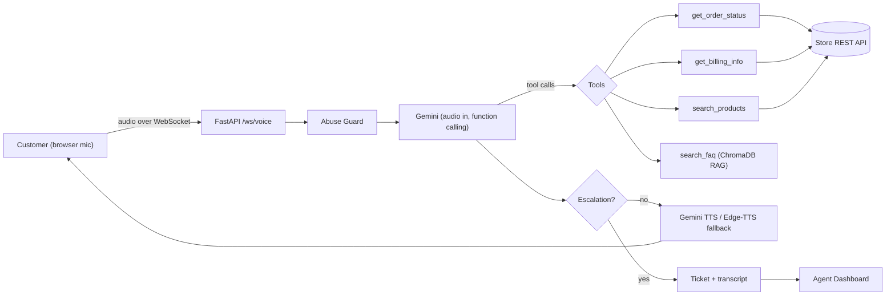

<div align="center">

# 🎙️ AI Voice Assistant

**A bilingual (English / Urdu / Roman Urdu) AI voice agent for e-commerce customer support, with RAG-powered answers, live tool calls, automatic human escalation and a full agent dashboard.**


</div>

> ⚡ **Part of [BRIHA](https://github.com/asad110abbas)**, built by Syed Asad Abbas.

---

## Overview

Customers call or open the voice chat and simply **talk**, in whichever language they're comfortable with.
Briha listens, understands, looks up real data (orders, billing, products, FAQs) and **speaks the answer back**.
When it can't help, or the customer asks for a person, it **hands off to a human agent** with a ticket and the full transcript.

## Architecture



## Features

**Voice agent**
- 🗣️ Real-time voice conversation over WebSockets, with speech in and natural speech out
- 🌐 Answers in English, Urdu or Roman Urdu, matching the customer's language automatically
- 🛠️ **Function calling**: order status, billing, product search and FAQ lookup against a REST API
- 📚 **RAG knowledge base**: FAQ documents embedded with Sentence-Transformers and stored in ChromaDB
- 🚨 **Smart escalation**: keyword detection, an unresolved-turn counter and API-failure fallback all create a ticket for a human
- 🛡️ **Abuse guard**: profanity and abuse detection, auto-blocklist, session duration limits
- 💸 Per-session **cost tracking** (audio minutes + output characters)

**Agent dashboard** (React + TypeScript)
- 📊 KPIs and charts: call volume, resolution time, agent performance
- 🎫 Ticket queue with assignment, notes, status workflow and email notifications
- 🎧 Call records with audio playback and full transcripts
- 👥 Agent management (admin / agent roles, JWT auth, bcrypt hashing)
- 📤 Export tickets and calls to PDF / CSV
- 🚫 Blocklist management

## Tech stack

| Layer | Technologies |
|---|---|
| AI | Google Gemini (audio understanding, function calling, TTS), Edge-TTS fallback |
| RAG | ChromaDB, Sentence-Transformers (`all-MiniLM-L6-v2`), python-docx ingestion |
| Backend | Python, FastAPI, WebSockets, SQLAlchemy, PyJWT, passlib/bcrypt, ReportLab, Loguru |
| Frontend | React, TypeScript, Vite, Tailwind CSS, Recharts |
| Testing | pytest (28 tests) with mocked LLM and HTTP layers |
| Ops | Docker, Docker Compose |

## Quick start

```bash
git clone https://github.com/asad110abbas/ai-voice-assistant-pro.git
cd ai-voice-assistant-pro
cp .env.example .env      # add GEMINI_API_KEY, JWT_SECRET, ADMIN_PASSWORD, AGENT_PASSWORD
docker compose up --build
```

- Dashboard: http://localhost:5173 (sign in with `ADMIN_EMAIL` / `ADMIN_PASSWORD`)
- API docs: http://localhost:8000/docs

**Without Docker:**

```bash
python -m venv .venv && source .venv/bin/activate     # Windows: .venv\Scripts\activate
pip install -r requirements.txt
uvicorn dashboard.backend.main:app --reload

cd dashboard/frontend && npm install && npm run dev
```

**Tests:**

```bash
pytest -q
```

## Knowledge base

The assistant answers policy questions from `data/sample_faqs.docx`, a **synthetic** FAQ for a fictional electronics store.
To use your own, write one paragraph per answer in the form `"Topic: <name>. <answer>"` and point `FAQ_PATH` at the file.
Regenerate the sample with `python scripts/make_sample_faqs.py`.

The store API (`STORE_API_URL`) is optional. Without it, the assistant still talks, answers FAQs and escalates.

## Project structure

```
src/
  api/store_client.py     REST client for orders, billing, products, tickets
  brain/                  RAG retriever, escalation logic, conversation memory
  multimodal/             Gemini client: audio -> tools -> response
  abuse_guard.py          abuse detection and blocklist
dashboard/
  backend/                FastAPI app, routers, auth, exports, email
  frontend/               React + TypeScript dashboard
config/settings.py        environment-driven configuration
tests/                    pytest suite
```

## Deployment

| Target | How |
|---|---|
|  **Docker Compose** | `docker compose up --build` runs the FastAPI voice backend and the React dashboard as containers |

## License

[MIT](LICENSE)
